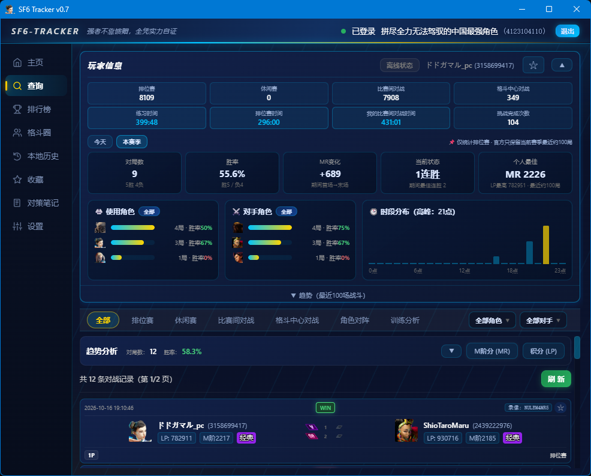

# SF6 Tracker

《街头霸王 6》战绩查询与复盘工具 · **v0.7**

本项目为非官方工具。FastAPI 提供本机服务，原生 HTML / CSS / JavaScript 展示数据，pywebview 提供 Windows 桌面窗口。



[使用与登录](#usage) · [本地开发](#development) · [目录结构](#structure) · [数据与隐私](#privacy) · [测试与打包](#verification) · [开发规范](#contributing) · [技术说明](#technical)

## 功能

- 查询自己或其他玩家的近期对局，查看胜负、角色、LP / MR 趋势、排行榜与格斗圈。
- 本地历史按被查询玩家 ID 归档、去重合并；资料失败时保留旧快照，支持离线查看和手动更新。
- 训练分析在页面内展示近期表现、常见败局和数据标签，可主动加载同角色榜首 / 前 3 名参考，或抽一场败局加入待复盘。
- 排行榜统计提供 MR 分布、实际门槛、角色占比和参考玩家；统计样本不代表全服人口或角色强度。
- 对策笔记只提供“我的角色 → 对手角色”的一个文本框，自行编辑、自动保存，支持导入导出。
- 收藏对局可在卡片内展开备注，输入即保存，收起显示摘要；备注与复盘状态独立。
- 提供暗色、亮色与春丽主题，以及布局密度设置。

现有在线页面是主要入口，本地历史只是补充；不提供登录账号切换或“哪个账号查询了谁”的管理模型。整理目录不改变界面布局或统计数据。

## 静态官网

`site/` 是独立的产品介绍与下载官网，包含实机截图、宣传片、功能说明和 GitHub Releases 入口，无需后端或构建步骤。它不接收 Cookie，也不提供在线查询。

本机运行 `powershell -ExecutionPolicy Bypass -File .\site-tools\preview.ps1` 可预览；部署时仅上传 `site/` 内容。已准备手动触发的 GitHub Pages 工作流，以及 Cloudflare Pages 上传包与配置说明，详见 [官网预览与部署](site-tools/README.md)。

<a id="usage"></a>

## 使用与登录

从 [GitHub Releases](https://github.com/HuuuugePony/sf6-tracker/releases) 下载已发布的 Windows 版本。发布包可能落后于开发分支，以版本说明为准。

1. 启动应用，点击“登录” → “打开默认浏览器访问官网”。
2. 在平常使用的浏览器中手动完成 CAPCOM 登录和人机验证。
3. 按“如何获取 Cookie”导入 Buckler 官网 Cookie，点击“验证 Cookie 并登录”。
4. 在主页或查询页查看战绩；离线时打开“本地历史”，选择已保存的玩家。

应用不接收账号密码，不自动读取普通浏览器的用户资料。备用“Edge 自动读取 Cookie”仍使用 WebDriver 临时窗口，不保证能通过官网人机验证；反复失败时改用普通浏览器 + Cookie，不连续重试、不绕过验证。桌面端需要 Microsoft Edge WebView2 Runtime。

**Cookie 是登录凭证，不是无风险的登录方式。** 默认仅会话保存，主动勾选“在此设备记住登录”后才写入未加密的长期存储。不要分享 Cookie、截图认证头或把账号文件放进 Git。

<a id="development"></a>

## 本地开发

在项目根目录运行，无需前端构建步骤：

```powershell
python -m venv .venv
.\.venv\Scripts\python.exe -m pip install -r requirements.txt

# 桌面模式
.\.venv\Scripts\python.exe desktop_app.py

# 或 Web 模式（两种模式不要同时启动）
.\.venv\Scripts\python.exe main.py
```

Web 模式访问 `http://127.0.0.1:7648`。服务仅应监听本机，不要暴露到公网或用作多用户服务。

<a id="structure"></a>

## 目录结构

```text
sf6-tracker/
├── README.md                 # 唯一的项目说明，技术细节按需展开
├── main.py                   # Web / API 启动入口
├── desktop_app.py            # 桌面启动入口
├── requirements.txt
├── requirements-dev.txt
├── sf6_tracker/              # 后端业务模块
│   ├── crawler.py            # 官网请求与采集调度
│   ├── battle_data.py        # 对局响应校验与解析
│   ├── collection_stream.py  # 分批采集事件
│   ├── history_api.py        # 本地历史接口
│   ├── history_store.py      # SQLite 归档
│   ├── login_sessions.py     # 临时登录会话生命周期
│   ├── player_analytics.py   # 榜单与高手参照统计
│   └── paths.py              # 运行文件目录
├── web/                      # 页面、脚本、通用及桌面样式
├── site/                     # 独立静态官网、实机图片和网页视频
├── site-tools/               # 官网预览、素材处理、验收与部署说明
├── assets/                   # 图标、界面截图与旧版截图归档
├── packaging/sf6tracker.spec  # PyInstaller 打包配置
├── tests/                    # 离线回归、合成数据预览与性能基准
└── runtime/                  # 本地日志、角色缓存与旧调试文件（忽略提交）
```

`build/`、`dist/`、`.venv/` 和 `.ui-previews/` 是本机生成目录，不纳入版本管理。原根目录运行文件已保留在 `runtime/`；没有清理个人数据。启动仍使用原来的两个根目录入口，业务模块的导入路径改为 `sf6_tracker.*`。

<a id="privacy"></a>

## 数据与隐私

| 数据 | 保存位置与规则 |
| --- | --- |
| 本地历史与资料 | 默认 `%LOCALAPPDATA%/SF6Tracker/history.sqlite3`；用 `SF6_TRACKER_DATA_DIR` 自定义，整理目录不搬动数据库 |
| 日志、角色缓存 | 默认项目目录 / EXE 旁的 `runtime/`；可用 `SF6_TRACKER_RUNTIME_DIR` 自定义可写目录 |
| 登录状态 | 浏览器 / WebView 的 sessionStorage；勾选记住后用未加密 localStorage |
| 收藏与对局备注 | localStorage 的 `sf6_favorite_battles`，备注按录像 ID 保存 |
| 对策笔记 | 独立键 `sf6_matchup_notes_v1`，当前数据格式 v2；旧分栏及已采纳来源合并为可编辑纯文本 |

- 退出登录和清理临时缓存不删除笔记、收藏及本地战绩；清除站点 / WebView 数据仍会删除浏览器中的资料。
- 浏览器与桌面端存储可能分开。对策笔记可导出 JSON；历史数据库备份前先退出应用，再复制整个数据目录。
- 官网近期窗口不是完整历史。本地积累从首次保存开始，无法补回官网已不再提供的对局。
- 当前采集使用有界并发、空页停止调度、有限重试和连续页分批显示；不承诺固定提速，官网限流与网络会影响耗时。
- 资料快照中的在线状态不是实时状态；不同统计期间、账号近 100 战趋势与角色样本不能混为一谈。
- 账号文件、真实 Cookie、日志、缓存、调试响应、数据库和构建产物均不得提交；本机数据不构成多用户权限隔离。

<a id="verification"></a>

## 测试与打包

安装测试依赖并运行离线检查（前端测试另需 Node.js）：

```powershell
.\.venv\Scripts\python.exe -m pip install -r requirements-dev.txt
.\.venv\Scripts\python.exe -m unittest discover -s tests -v
node --test tests/frontend_reliability.test.js

# 独立临时数据库 + 演示存储，不读取真实账号
.\.venv\Scripts\python.exe -m tests.preview_server

# 采集调度基准：模拟延迟，不代表官网实测
.\.venv\Scripts\python.exe -m tests.benchmark_collection
```

预览服务监听 `http://127.0.0.1:7650`：`/preview` 查看基础界面；`/preview-history` 验收本地更新；`/preview-online` 验收渐进显示；`/notes` 验收离线笔记。预览存储与真实笔记 / 收藏隔离。

```powershell
.\.venv\Scripts\python.exe -m PyInstaller packaging/sf6tracker.spec --clean --noconfirm
```

在根目录执行打包命令，配置内部按自身位置解析资源。产物位于 `dist/`；只收集明确列出的资源，不打包运行数据或测试账号。真实登录、验证码、WebView2 窗口与最终 EXE 仍需手工验收，离线测试通过不等于已验证这些流程。

问题反馈：[GitHub Issues](https://github.com/HuuuugePony/sf6-tracker/issues)。本项目与 CAPCOM 无隶属关系，游戏及相关素材的权利归其权利人所有。

<a id="technical"></a>

## 技术说明与维护规范

以下内容合并自原有分散文档，作为统一维护入口；日常使用无需展开。

<a id="contributing"></a>

<details>
<summary>开发与 Git 规范</summary>

### 开发与 Git 规范

#### 界面边界

现有在线页面的数据内容和布局是基准。修复稳定性、拆分内部代码或新增本地能力，不应顺带调整信息顺序、折叠状态、卡片布局和筛选控件。视觉变化先确认范围，再提供前后对照。

本地历史只按被查询玩家保存；不增加“哪个账号查了谁”的模型或登录账号切换。新功能优先复用已有按钮、间距、颜色和交互。

#### 分支

- `main`：已验收、可发布，不进行日常开发。
- `develop`：日常开发和集成，提交前完成对应测试。
- 不重写已共享历史，不默认强推。发布时把已验收的 `develop` 合入 `main`，用版本标签标记发布点。
- 本规范不自动提交工作区或推送远端。脏工作区切换分支，不意味着改动已保存到提交中。

正常发布时，先保证工作区干净且验收完成：

```powershell
git switch main
git merge --no-ff develop
# 按实际版本打标签，例如：git tag -a v0.7 -m "Release v0.7"
git switch develop
git merge main
```

##### 从远端 master 迁移

本地改名不会更改 GitHub 默认分支。仓库管理员确认迁移时再执行：

```powershell
git push -u origin main
git push -u origin develop
```

随后在 GitHub 将默认分支设为 `main`，检查 CI / 发布脚本中的 `master` 引用，并设置分支保护：`main` 禁止强推与删除，合入前要求测试通过。多人协作时通过 PR 合入。旧远端 `master` 先保留，迁移完成后再决定是否删除。

#### 提交格式

使用 `type(scope): 中文说明`，例如：

```text
feat(history): 按玩家保存本地战绩
fix(auth): 忽略已取消的登录响应
refactor(frontend): 拆分请求处理，保持界面不变
docs(readme): 更新本地运行说明
test(history): 覆盖旧数据库迁移
chore(git): 排除运行缓存和账号文件
```

允许类型：`feat`、`fix`、`refactor`、`perf`、`docs`、`test`、`build`、`ci`、`chore`、`revert`。`scope` 可省略；说明须表达目的，避免“优化一下”“更新”等标题。破坏兼容时在正文说明影响与迁移步骤。

一次提交解决一个问题，相关实现和测试一起提交。不把界面、重构、数据迁移和文档都塞进大提交，也不为拆分留下无法运行的中间状态。

#### 提交前检查

1. `git status --short`：只包含本次修改，不混入账号文件、玩家信息、日志、缓存、数据库或构建产物。
2. 按文件或补丁暂存：`git add -- <明确路径>` 或 `git add -p`，避免未经检查的 `git add .`。
3. `git diff --cached --check` 与 `git diff --cached`：检查最终内容，不传播真实凭据。
4. 后端运行 `python -m unittest discover -s tests -v`；前端逻辑运行 `node --test tests/frontend_reliability.test.js`。
5. 界面修改检查最小桌面窗口、主题和原有在线流程；归档修改检查重复同步、断网、重启和数据库兼容；打包配置修改另行验收 EXE。

当前格式以文档约定，不修改全局 Git 配置，也不自动安装钩子。测试目录只允许已知回归代码和说明，其他文件仍默认忽略，避免测试账号意外纳入版本管理。

</details>

<a id="architecture"></a>

<details>
<summary>架构与模块边界</summary>

### 前端模块与数据边界

本项目继续使用无需构建步骤的静态页面。入口 `web/index.html` 显式按顺序加载 `defer` 脚本；桌面包包含整个 `web/` 目录。

为兼容现有页面内事件入口，这一轮采用职责脚本共享同一页面作用域，未引入打包器。共享绑定由 `state.js` 声明，原有排行榜、角色、格斗圈各自持有其领域状态。所有业务调用都在脚本初始化完成后执行。模块之间不通过源码拼接或动态加载运行。

| 文件 | 职责 |
| --- | --- |
| `app.js` | 启动、路由、顶层导航、版本提示 |
| `state.js` | 账号状态、请求标识、战绩状态、页面快照与账号清理 |
| `api.js` | 通用 JSON 请求、超时、取消和错误归一化 |
| `auth.js` | 浏览器登录、Cookie 验证、恢复登录与退出 |
| `storage.js` | 本地收藏、备注、搜索历史和登录状态读写 |
| `battle-data.js` | 官网采集请求、响应归属与缓存更新 |
| `battle-render.js` | 战绩页、官方资料、对阵、卡片与分页 |
| `battle-filters.js` | 历史筛选与导出辅助逻辑；在线页面不渲染新增概览、筛选栏或复盘按钮 |
| `filter-handlers.js` | 原有角色与对手角色筛选入口；本地历史额外按对战类型过滤 |
| `history.js` | 本地玩家选择、资料快照恢复、分批读取、离线历史 |
| `exports.js` | JSON/CSV 序列化、完整历史筛选导出、浏览器与桌面保存 |
| `reviews.js` | 收藏对局、复盘状态与卡片内自动保存的对局备注 |
| `charts.js` / `reports.js` | 趋势图、筛选记录分析 |
| `insights.js` | 页面内训练分析、事实标签、分类双条对比与显式高手参考请求 |
| `matchup-notes.js` | 按角色组合保存的纯文本笔记、自动保存/备份与旧版迁移；不提供攻略资料 |
| `rankings.js` / `fighters.js` / `search.js` / `characters.js` | 对应功能域 |
| `utils.js` / `theme.js` | 编码、剪贴板、反馈与外观设置 |

新增页面状态或异步入口时，必须参与登录和退出的请求失效机制；归档使用响应对应的玩家身份，不读取完成时可变的页面状态。浏览器回归测试按 HTML 的实际脚本顺序执行。在线界面的数据、布局与控件不因内部重构而变更。

`sf6_tracker/player_analytics.py` 在已读取的榜单上计算分布，不为排行榜统计额外抓取个人资料。高手参照为独立手动入口：读取全球同角色榜第一页，去重排除本人后，最多3个独立客户端并行读取资料；不额外采集高手战绩，不混入本地玩家战绩归档。完整样本使用有界10分钟服务缓存，局部失败显式返回样本缺口且不缓存。原始字段覆盖信息随资料白名单保存，比较时缺失值不当作零。

训练分析作为 `currentViewMode=insights` 与“角色对阵”并列，复用战绩内容区，不遮罩页面。上方玩家资料始终保留，所有标签共享“下滚收起资料、内容到顶后上滚展开”的行为。分析复用内嵌报告的卡片、面板与字号，不再重复玩家标题或单独定义大号概览。口径和来源放在原生 `details` 中。后台记录更新保留当前角色和请求归属；离开分析或切换玩家会取消旧请求。原有战绩视图的资料、趋势图与卡片不变。

训练与统计角色选择均复用 `openCharacterPicker` / `renderCharPickerTrigger`。训练的败局抽签不发请求，加入待复盘复用原有收藏结构；角色切换清理旧抽签。统计排序、展开和MR对照保存在 `rankingState`，局部重绘保留滚动位置；点击角色看点才主动定位参考表，地区切换清理角色筛选。共享内容区的战绩滚轮联动在排行榜、格斗圈等页面不拦截事件。

`/notes?opponent=10&character=4` 为无需登录的单文本框对策笔记页；角色编号不对应账号。笔记惰性读取独立存储键，不参与账号清理；输入同步保存，失败保留内存草稿。导入校验全部字段并跳过已有组合，导出通过既有浏览器/桌面保存适配器生成白名单JSON。训练分析传递当前角色与对手，不传玩家身份。v2只保存content和更新时间；旧版分栏文字及已采纳来源合并成可编辑纯文本，原有通用笔记仅为兼容而保留。不加载内置攻略、验证标签或参考侧栏。

收藏对局的note字段随sf6_favorite_battles保存，以replay_id定位。卡片内details展开编辑，收起显示纯文本摘要，输入不重绘卡片以保留焦点。旧收藏没有note字段时按空处理；复盘状态更新保留备注。保存失败保留草稿和重试入口，未保存草稿存在时提醒离开。

排行榜、格斗圈及排行榜统计沿用原来的居中加载动画和文字，不显示连接计数或采集页数。名字搜索在请求发出前显示连接提示。列表请求 30 秒、统计请求 60 秒超时并释放加载状态；战绩查询的分批采集进度保持独立。

### 本地历史

`sf6_tracker/history_store.py` 使用 SQLite 事务保存战绩，主键为 `(玩家 ID, 录像 ID)`。不保存查询账号，不提供登录账号切换。重复查询更新记录，官网不再返回的旧记录保留。写入只接受战绩字段白名单，不接受 Cookie。旧版账号分组会一次性合并为玩家历史，重复录像使用最近同步数据，旧表保留为恢复副本。

默认文件为 `%LOCALAPPDATA%/SF6Tracker/history.sqlite3`。开发和测试可使用 `SF6_TRACKER_DATA_DIR` 指定独立数据目录。数据库不会打入 EXE，清理临时缓存也不会删除它。

`player_profiles` 以 `player_id` 为主键，保存白名单资料 JSON 与更新时间，与战绩同一事务写入。成功采集资料后更新快照，失败时保留旧资料；旧数据库自动升级，已有战绩保留。离线接口返回 `user_info`、`player_profile` 和 `profile_updated_at`，前端复用在线资料及角色对阵渲染，切换玩家时清空上一个玩家的资料。在线状态不作为实时信息展示。

`sf6_tracker/history_api.py` 只服务本机历史，不请求官网。入口仅选择已保存的玩家，不需要官网登录。首次加载最多 2000 条，可继续加载；导出会读取该玩家的全部历史，再应用点击导出时的筛选条件。进入本地历史不更改登录玩家身份。“更新数据”单独调用已有玩家查询 API，使用当前登录态更新所选玩家，完成保存后重新读取合并后的本地数据。切换玩家、离开页面或更改登录态会使旧更新请求失效；离线点击会提示登录并保留所选玩家。

`sf6_tracker/collection_stream.py` 为采集接口提供可选 NDJSON 流，旧 JSON 调用仍兼容。每次采集持有独立队列和上下文，顺序为零到多个 `progress`、一个 `complete` 或 `error`。前端仅在收到完整结果后确认成功；断流保留已有数据并报告未完成。采集器只推送已连续返回的页，避免将后页误作最新数据；刷新期间合并显示已有数据，最终以本次结果窗口为准。断开连接后停止安排新的页请求，已发出的请求在各自的超时与重试范围内结束。

在线页面恢复 v0.6 的玩家资料、内嵌报告、趋势图和战绩卡片布局，保留原来的刷新与星标入口；不增加概览卡、整排筛选或独立报告折叠区。正常加载完成后不额外显示归档统计横条，仅在异常或数据不完整时提供提示。本地积累从首次保存开始，无法补回官网已不提供的旧战绩。CSV 序列化使用 UTF-8 BOM、标准引号转义，并防止文本被电子表格解释为公式。

</details>

<a id="collection-technical"></a>

<details>
<summary>采集性能与测量</summary>

### 采集性能与稳定性

#### 当前判断

代码默认读取 10 页，以 5 个战绩请求并发，并行读取一份玩家资料。原有 JSON 接口要等整批完成才返回，所以一页资料慢或一个请求重试，会延后所有已返回战绩的显示。正常满页采集至少需要两轮战绩请求；已有连接池和 build ID 缓存，直接增大连接池不会减少这些请求。尚未用真实账号做官网测速，不能据此断定网络、官网或本机哪一段占比最高。

#### 已落地

- **先显示连续返回的战绩。** 可选 NDJSON 接口持续推送结果；慢资料不再阻塞战绩展示，进度提示会说明仍在采集。最终收到完成事件才算成功，断流不会被视为完整结果。刷新时保留已有记录，最终结果仍遵循所选类型和页数。
- **控制请求与重试。** 保持默认 5 个战绩请求并发，空页停止后续调度，临时页面错误并行重试。传输层的重试预算用尽后不再叠加一轮页面重试，避免原来最多 3 × 2 次尝试；遵循传输层对 429 和 Retry-After 的处理。
- **本地更新明确合并。** “更新数据”采集所选玩家的全部类型近期窗口，事务合并录像并更新有效资料，随后重新读取本地历史。已有旧对局保留；局部成功会提示缺失范围；保存失败不显示更新成功。
- **取消和隔离。** 同一在途请求去重；请求独立持有玩家状态；离开页面或切换玩家会阻止旧结果覆盖新视图。流断开后不再调度后续页，已经发出的请求仍需在超时和重试范围内结束。

使用 FastAPI 原生 [StreamingResponse](https://fastapi.tiangolo.com/advanced/custom-response/#streamingresponse)；连接池行为参考 [Requests 文档](https://requests.readthedocs.io/en/stable/user/advanced/#session-objects)，重试预算与 Retry-After 参考 [urllib3 文档](https://urllib3.readthedocs.io/en/stable/reference/urllib3.util.html#urllib3.util.Retry)。未新增运行依赖。

#### 如何测量

`python -m tests.benchmark_collection` 使用模拟延迟，运行三轮取中位数，并检查返回的录像集合。一次运行结果如下：

| 场景 | 对比基准 | 当前方式 |
| --- | --- | --- |
| 10 页正常响应，每页模拟 100 ms | 完成约 202 ms | 完成约 202 ms |
| 空历史 | 完成约 202 ms，10 次请求 | 完成约 102 ms，5 次请求 |
| 3 页临时失败 | 完成约 1503 ms | 完成约 304 ms |
| 资料模拟延迟 600 ms | 等整批完成约 602 ms 才可显示 | 首批约 102 ms 可显示，完整完成仍约 602 ms |

前三项基准复现的是之前的整批调度、固定等待和串行重试方式，不代表本次修改单独带来的收益。第四项用于比较本次分批展示与整批展示。所有结果均不是官网实测。

流式采集最终的 `collection.first_result_ms` 记录采集器开始到首批连续页可用的耗时，`collection.elapsed_ms` 为采集器完整耗时；二者不含构建采集器前的 build ID 获取及前端渲染，不能直接当作点击到显示的端到端耗时。

#### 进一步减少总耗时

下一步优先考虑带校验的增量同步：按玩家及对战类型保存“已连续同步到哪里”，刷新时补新窗口，并定期重新校验旧窗口。必须处理历史缺页、官网分页移动、跨类型切换和上次部分失败，不能遇到任意一条已有录像就停止。此策略尚未启用；当前仍实际读取所请求的近期窗口，避免漏掉对局。

是否改用 HTTP/2 或提高并发，应先用相同账号和页数比较官网实测的首次结果、完整耗时、失败与限流率。当前没有测量证据支持更换 HTTP 库或提高默认并发。

</details>

<a id="analytics-technical"></a>

<details>
<summary>玩家统计与高手参照口径</summary>

### 从数据到练习

目标是帮助玩家回答三个问题：常见对手有哪些、败局集中在哪里、下一次练习要验证什么。保留战绩主界面，在“角色对阵”旁增加“训练分析”页内切换；排行榜只调整“数据统计”内容。默认以关键数字、条形对比和标签为主，统计口径与来源收起，不使用训练分析弹窗。

#### 借鉴与依据

- [Capcom 的 Drive System 介绍](https://news.capcomusa.com/2022/06/02/street-fighter-6-redefines-the-genre-in-2023/)说明资源同时服务进攻与防守，耗尽会进入 Burnout。因此不把某项资源“使用更多”直接当作更好，也不从被眩晕次数反推出燃尽时长。具体机制与费用会随版本变化，这里不内置招式帧数或费用表。
- [SF6 Stats 数据说明](https://sfstats.app/data/reference)区分官方快照、个人保存的对局与高手参照，并说明账号习惯不等于单角色习惯。这一版借鉴其比较口径与缺失值表达，不复制第三方数据，也不向第三方发送Cookie或玩家资料。
- [SF6 Checker](https://sf6checker.egaz.uk/stats/matchup-master/)区分环境相性和个人相性。这里优先分析玩家自己常遇到且常输的对手；当前没有导入环境相性库，不把个人胜率标成角色的普遍优劣。

#### 排行榜统计

在已有请求结果上去除同一玩家同一角色的重复条目，再计算以下项目，不新增批量个人采集：

- 有效条目、可识别的不同玩家数、角色数量。
- 有效正MR的均值、中位数、25%和75%分位、范围。MR缺失或为零时不加入分布。
- 实际返回的 #1/#10/#50/#100/目标位次门槛；没有拿到的位次不推算。
- 角色出现占比、角色内MR中位数与最高值、前100样本的占比及与全样本的百分点差。
- 已返回地区的分布和每个角色最多3位参考玩家。

同玩家不同角色可以分别占条目，因此条目不等于人数。前100按官网返回的有效位次筛选，不将地区榜自动解释成全服位次。当前样本不代表全服MR人口、天梯角色胜率或角色强度；单个高手、稀有角色与小样本都会影响结果。沿用当前排行榜的平台参数和赛季口径，页面显示地区、更新时间、缓存状态和实际样本量。

展示采用紧凑概览、门槛条、并排分布、角色参考表四层。角色占比和参考表默认最多8项，更多角色手动展开；每行默认显示1位参考，其他参考按需展开。角色排序、头像筛选、MR门槛对照均只使用已有统计，不触发新采集。点击看点或角色占比会定位并展开对应参考表。未知地区不单独占据板块。

榜单看点只描述出现情况：最多条目的角色；头部样本至少20条、该角色全样本至少5条且头部至少3条时，展示正占比差最大的角色；其他角色中至少3条记录且存在有效最高MR时，可展示较少见的参考。它们不等于角色强弱或个人遭遇概率。MR对照仅计算输入值减已读取门槛，不插值、不推算排名。

#### 个人训练分析

分析当前报告期间内已加载的排位记录，可选择角色。先按录像ID去重，平局和未知结果不加入胜负分母。日期无效的记录不参与近期变化；非排位记录不混入。

- 最近20场与此前20场仅在各满20场时比较。MR观测变化只在同一角色内计算有效首末赛前值，不能当作完整结算收益。
- 对手角色按败局数排序；至少10场且胜率低于50%才进入练习候选。显示场数及 Wilson 95%参考区间；连续对局不保证独立，区间不是严格的人群推断。
- “50%目标情景”计算上述候选的 `Σ(0.5 × 场数 − 胜场)`。它是假定对手分布不变的静态目标，不是未来胜率、训练因果或MR涨幅预测。
- 回合胜率只计算明确胜负的已知编码，平局和未知编码不计。先丢/先赢首回合后的整场胜率保留分母，不替代对空、起身或防守成功率。
- 对手强度按有效双方MR差分为高100以上、差距小于100、低100以上，仅作该角色的对局结果分组。
- 标签只描述有规则的事实：少于20场为“样本积累中”；至少20条总样本且角色占比≥70%为“主修”；完整两组20场胜率相差≥10个百分点才标注回升或回落。标签不评价人格或固定技术能力。
- “抽一场败局”仅从当前期间、角色的已加载排位败局中抽取有录像ID的记录，优先避免连续重复。玩家可复制ID或显式加入原有待复盘收藏，不自动保存；已有收藏不重复添加或重置状态。

#### 高手参照

玩家手动点击后，查询与应用排行榜同口径的全球角色榜第一页。排除本人、重复身份及角色冲突，取前3位其他玩家；并行读取至多3份资料，不读取这些玩家的多页战绩。默认比较可用样本中位数，也可选首位样本。首位资料失败时不擅自用次位冒充。

服务器完整样本缓存10分钟，最多64组；浏览器最多保存32组公开参考快照，包含来源身份与采集时间，不含Cookie。不同角色及排除本人身份分开缓存；部分失败不记为完整缓存，页面显示实际可用份数，单项有效样本数放在差值的悬停提示。打开分析不自动联网，已有参考可离线查看。

双方行为指标均为官网账号近100战趋势，不是所选角色的独立数据，无法保证版本、对手强度及模式完全一致。只显示相同字段的原值与差值：资源占比按百分比展示，差值按百分点展示；其他字段保留官网趋势值，不冒充成功率。差异不是“离高手还差多少MR”，也不是越接近越好。

新资料记录实际返回的数字字段覆盖。旧资料中的非零值可使用，缺少覆盖标记的零值无法判断是观察值还是默认值，显示缺失；重新成功查询后补齐覆盖。未知字段、缺失资料、不匹配角色及失败样本不补零。

接口没有可靠的逐帧事件信息，当前不计算对空率、连段失误率、真实拆投成功率、燃尽时间或起身防守成功率。建议定位后仍需结合录像和训练模式验证。没有接入生成式教练服务，不把这些数据传给外部AI。

</details>

<a id="login-technical"></a>

<details>
<summary>登录可靠性与安全边界</summary>

### 登录可靠性与安全边界

核对日期：2026-10-16。未读取测试账号文件，未对真实账号进行自动登录或人机验证尝试。

#### 已确认与尚未确认

旧流程固定调用 `webdriver.Edge()`，每次使用临时自动化窗口，等待整个页面加载。页面超过45秒未完成会被当成启动失败并关闭，可能中断用户正在完成的验证。这是代码可复现的问题，不是已证实的官网拒绝原因。

仅凭“人机验证反复失败”无法确定是Edge版本、自动化环境、临时会话、网络、扩展或官网风控。没有验证响应和人工对照结果，不应声称换Chrome必定解决，也不应伪造浏览器指纹或绕过验证。

- [Microsoft：Edge WebDriver用于自动化测试](https://learn.microsoft.com/en-us/microsoft-edge/webdriver/)
- [Selenium：验证码明确用于阻止自动化](https://www.selenium.dev/documentation/test_practices/discouraged/captchas/)
- [Selenium：页面加载策略](https://www.selenium.dev/documentation/webdriver/drivers/options/)

#### 当前流程

推荐入口只通过系统默认浏览器打开固定Buckler官网地址，不添加自动化参数，不读取用户浏览器数据库、其他网站Cookie或密码。登录和验证码由用户手动完成，然后自行导入Buckler Cookie。它与备用自动读取是两种不同流程，不是“普通浏览器自动读取”。默认浏览器若恰好是Edge，也仍是正常启动而非WebDriver窗口。

备用Edge自动读取仍保留：使用eager页面加载策略，超过45秒仍保留窗口，交给用户继续操作；只有取消、过期或完成才回收。它不会隐藏WebDriver、关闭浏览器安全功能或破解验证码。验证账号前检查已返回HTTPS Buckler页面，并只取streetfighter.com站点Cookie；没有Cookie时不请求验证接口。会话保留10分钟，取消、并发和晚到回调约束保持不变。

#### Cookie不是无风险凭证

Cookie可代表已登录会话，应按密码级别保护。新登录默认用sessionStorage；勾选记住后改用未加密localStorage。二者都可能被本机用户或同源脚本读取，sessionStorage也可能被浏览器恢复；这不是密码库或加密存储。旧版已保存的登录继续兼容，退出登录清除两处认证缓存，不删除笔记与本地战绩。

服务必须只监听本机，不能暴露到公网、多用户共享或添加不受信任的同源脚本。Cookie验证成功只说明当时有效，不保证后续长期有效，也不能承诺降低官网账号风控风险。不要将Cookie、账号文件或带认证头的日志提交Git、发Issue或截图分享。

#### 手工对照验收

1. 在同一网络中，手动从平时浏览器访问官网并完成人机验证；若普通Edge也失败，不能归因于WebDriver，应检查浏览器更新、官网提示与网络，避免连续重试。
2. 普通浏览器可登录时，导入Cookie验证账号，确认显示的是自己的账号。
3. 仅按需试一次备用窗口；若只有它失败，保留手动Cookie流程，不反复提交账号密码。
4. 验证“默认不记住”和主动记住的恢复、退出登录清理；不同浏览器与WebView可能有不同本地存储。

自动回归使用模拟浏览器与虚构Cookie，不请求官网、不打开真实浏览器、不触碰测试账号文件。真实验证码是否通过仍需用户手工验收。

</details>

<a id="notes-technical"></a>

<details>
<summary>本地笔记与兼容规则</summary>

### 本地笔记

对策笔记只提供工具：选择我的角色和对手角色，在一个文本框中自由编辑。无攻略预填、练习建议、验证状态或参考侧栏。输入即自动保存到本机，支持JSON导入导出，不需要登录。

沿用存储键sf6_matchup_notes_v1，数据格式升级为version 2，按角色组合保存content及更新时间。旧版各栏文字、已采纳的来源完整合并成可编辑文本；不会从旧内置参考重新填入任何内容。旧通用笔记保留，仅已有通用笔记时在角色选择中提供兼容入口。

导入兼容v1和v2，先完整校验，只补充缺少的角色组合，不覆盖已有内容。保存失败时保留内存草稿、提示重试/导出，关闭窗口提醒；损坏数据不自动覆盖。

收藏对局卡片中的“添加对局备注”在原地展开文本框，编辑即保存。收起后显示摘要，备注与复盘状态独立，旧收藏正常兼容。数据保存在sf6_favorite_battles的note字段，通过录像ID定位。保存失败保留本页草稿，可重试。

笔记及备注不参与退出登录或临时缓存清理；浏览器与桌面WebView存储可能不同，清除站点/应用数据仍会移除内容。删除收藏会同时移除该收藏的备注。

</details>

<a id="test-technical"></a>

<details>
<summary>测试覆盖与手工验收</summary>

### 离线回归检查

安装运行依赖及测试客户端后，在项目根目录执行：

```powershell
python -m pip install -r requirements-dev.txt
python -m unittest discover -s tests -v
node --test tests/frontend_reliability.test.js
```

后端使用模拟官网响应和本地测试客户端；前端使用 Node 内置测试工具和模拟页面环境。测试不读取真实 Cookie，不登录账号，也不请求官网。

覆盖并发玩家查询、静态资源边界、参数校验、采集失败与重试、build ID 更新、登录验证与取消、会话过期与浏览器回收、坏记录与异常页面、登录缓存清理、前端旧响应覆盖、完整分页、页面状态恢复、图表展开和收藏保护。SQLite 检查包括按玩家去重、并发事务、离线读取和旧版账号分组迁移；前端检查还包括导出转义、筛选一致性及实际脚本加载顺序。

桌面启动检查使用模拟套接字与健康响应，验证端口占用、服务实例身份和启动失败退出，不会打开 Edge 或桌面窗口。

完整的 Edge 登录和打包后 WebView 布局仍需手动验收。旧的 `/api/get-cookie` 已停用，统一使用 `/api/login/start`、`/api/login/confirm` 和 `/api/login/cancel`。

`preview_server.py` 可启动仅含模拟战绩的本地界面验收服务（端口 7650），使用独立临时数据库，不读取真实账号或 Cookie。访问 `/preview` 可同时检查桌面专用样式。

新增检查覆盖资料按玩家更新、失败保留旧资料、字段白名单、离线角色对阵、重复点击请求合并、空页停止调度、坏记录不误判为空页、并行重试及认证失败不重试。

`test_player_analytics.py` 和前端分析检查覆盖榜单样本与玩家数的区分、MR缺失值、分位数、重复条目、高手样本上限与本人排除、角色身份冲突、字段覆盖、百分点差、低样本练习候选、角色分数不混算、离线打开分析，以及离开分析后忽略旧参考响应。

界面优化检查覆盖头像选择器复用、当前角色排位败局抽签、待复盘队列幂等、MR门槛输入校验、头部看点样本门槛、缺失值排序、长列表默认收起、局部重绘保留滚动，以及排行榜滚轮不触发战绩资料收起。

对策笔记检查覆盖离线按角色组合保存、单文本框无攻略预填、旧分栏与来源转为纯文本、保存失败保留草稿与合并其他窗口笔记、损坏数据不覆盖、导入不覆盖现有条目及整包校验、纯文本/XSS，以及从训练分析携带正确角色上下文。收藏备注覆盖按录像ID保存、刷新恢复、不改变复盘状态、空备注、XSS和失败重试。预览服务把本地存储隔离至演示sessionStorage，笔记页可刷新验收，不写真实笔记或收藏。

排行榜与格斗圈检查覆盖原有居中加载提示、超时结束加载；统计检查乱序返回时保留排名顺序，以及部分失败不缓存成功结果。这两类页面不显示采集页数进度。预览服务提供延迟模拟响应，可从演示登录页面的侧栏进入验收。

更新与流式采集检查包括：仅更新所选玩家、归档失败保留原数据、切换玩家忽略旧结果、登录后保留本地选择、资料慢时战绩先可见、后页先返回时不冒充首页、分块 UTF-8 解码、断流不误报完成、传输重试耗尽后不重复整轮请求，以及取消后停止调度。预览服务以模拟采集器替代官网请求，`/preview-history` 可验收更新按钮，`/preview-online` 可验收慢资料下的渐进显示；两者使用演示登录态。

运行 `python -m tests.benchmark_collection` 可比较旧调度方式与当前采集器。基准使用模拟延迟，不请求官网，并核对两者返回相同录像集合；报告正常满页、空历史和临时失败场景的多轮中位耗时与请求数。模拟结果不能视为真实网络提速承诺。
### 登录回归补充

登录回归仅用模拟驱动和虚构Cookie，覆盖普通浏览器固定官网入口、加载超时保留窗口、HTTPS Buckler来源检查、空Cookie拦截、会话默认保存及主动记住/退出清理。不得读取本目录的私人账号文件或自动处理官网验证码；真实登录按 [手工验收说明](#login-technical) 操作。

</details>

<a id="schema-reference"></a>

<details>
<summary>历史原始 JSON 字段备忘</summary>

历史原始响应字段备忘，不是当前前端指标的单位或含义保证。统计口径以实际解析、字段覆盖及上面的分析说明为准；角色清单以运行时官网清单为准。

### SF6 玩家信息 JSON 数据结构注释说明

#### 顶层结构
```json
{
  "pageProps": { ... },    // 页面属性，包含所有玩家数据
  "__N_SSP": true          // Next.js 服务端渲染标志
}
```

---

#### pageProps.fighter_banner_info - 玩家基本信息横幅

| 字段名 | 类型 | 说明 |
|--------|------|------|
| `allow_cross_play` | boolean | 是否允许跨平台对战 |
| `battle_input_type` | int | 战斗输入类型（0=经典，1=现代） |
| `custom_room_invite_setting` | int | 自定义房间邀请设置（1=允许） |
| `enjoy_total_point` | int | 娱乐总积分 |
| `favorite_character_id` | int | 最爱角色ID |
| `favorite_character_league_info` | object | 最爱角色的段位信息 |
| `favorite_character_play_point` | object | 最爱角色的游玩点数 |
| `friend_request_flag` | boolean | 是否有好友请求 |
| `friendship` | int | 好友关系状态（1=已是好友） |
| `home_id` | int | 主页/地区ID |
| `inside_rank` | int | 内部排名 |
| `is_circle_invite` | boolean | 是否接受公会邀请 |
| `is_circle_member` | boolean | 是否是公会成员 |
| `last_play_at` | int | 最后游玩时间戳（Unix时间） |
| `main_circle` | object | 主公会信息 |
| `max_content_play_time` | object | 最大游玩时间的内容类型 |
| `mobile_linkage` | boolean | 是否绑定移动端 |
| `online_status_info` | object | 在线状态信息 |
| `personal_info` | object | 个人身份信息 |
| `play_time_zone` | object | 常玩时间段 |
| `profile_comment` | object | 个人资料标签/评论 |
| `title_plate` | int | 称号牌ID |
| `home_name` | string | 地区名称（如"中国"） |
| `favorite_character_name` | string | 最爱角色中文名 |
| `favorite_character_alpha` | string | 最爱角色显示名 |
| `favorite_character_tool_name` | string | 最爱角色英文名（用于工具/API） |
| `title_data` | object | 称号数据 |
| `is_my_data` | boolean | 是否是当前登录用户自己的数据 |

---

#### fighter_banner_info.favorite_character_league_info - 最爱角色段位信息

| 字段名 | 类型 | 说明 |
|--------|------|------|
| `league_point` | int | 段位积分（-1表示未定级） |
| `league_rank` | int | 段位等级编号 |
| `master_league` | int | Master段位等级（0表示非Master） |
| `master_rating` | int | Master评分（仅Master段位有效） |
| `master_rating_ranking` | int | Master评分排名 |
| `league_rank_info.league_rank_name` | string | 段位名称（如"Diamond4"） |
| `league_rank_info.league_rank_number` | int | 段位星级（如4星） |

---

#### fighter_banner_info.personal_info - 个人身份信息

| 字段名 | 类型 | 说明 |
|--------|------|------|
| `fighter_id` | string | 玩家ID/用户名 |
| `platform_id` | int | 平台ID（5=Steam） |
| `short_id` | int | 短ID（用于快速查找） |
| `platform_name` | string | 平台显示名称（如"Steam"） |
| `platform_tool_name` | string | 平台工具名称（如"steam"） |

---

#### fighter_banner_info.online_status_info - 在线状态信息

| 字段名 | 类型 | 说明 |
|--------|------|------|
| `online_status` | int | 在线状态码（1=离线） |
| `online_status_data.online_status_name` | string | 在线状态名称（如"离线状态"） |
| `online_status_data.online_status_type` | int | 在线状态类型 |
| `battlehub_admission_restriction` | int | 格斗中心准入限制 |
| `battlehub_id` | string | 格斗中心ID |
| `battlehub_platform_id` | int | 格斗中心平台ID |
| `battlehub_region_id` | int | 格斗中心区域ID |
| `battlehub_server_no` | int | 格斗中心服务器号 |
| `custom_room_master_short_id` | int | 自定义房间房主短ID |
| `custom_room_platform_id` | int | 自定义房间平台ID |
| `custom_room_publish_setting` | int | 自定义房间公开设置 |
| `custom_room_region_id` | int | 自定义房间区域ID |
| `custom_room_required_network_connection_quality` | int | 自定义房间网络质量要求 |
| `custom_room_required_pass_code` | boolean | 自定义房间是否需要密码 |
| `custom_room_room_id` | string | 自定义房间ID |

---

#### fighter_banner_info.play_time_zone - 常玩时间段

| 字段名 | 类型 | 说明 |
|--------|------|------|
| `start_hour` | int | 开始小时（24小时制） |
| `start_minute` | int | 开始分钟 |
| `end_hour` | int | 结束小时 |
| `end_minute` | int | 结束分钟 |

---

#### fighter_banner_info.profile_comment - 个人资料标签

| 字段名 | 类型 | 说明 |
|--------|------|------|
| `profile_tag_id` | int | 标签ID |
| `tag_option_id` | int | 标签选项ID |
| `profile_tag_name` | string | 标签模板（如"{{message1}}年后回归"） |
| `profile_tag_option` | string | 标签选项值（替换模板中的占位符） |

---

#### fighter_banner_info.title_data - 称号数据

| 字段名 | 类型 | 说明 |
|--------|------|------|
| `title_data_id` | int | 称号ID |
| `title_data_grade_id` | int | 称号等级ID |
| `title_data_grade_name` | string | 称号等级名称（如"銅"） |
| `title_data_plate_id` | int | 称号牌ID |
| `title_data_plate_name` | string | 称号牌资源名称 |
| `title_data_val` | string | 称号文本内容（如"大家好"） |

---

#### pageProps.play - 游玩统计数据

##### play.base_info - 基础游玩信息

| 字段名 | 类型 | 说明 |
|--------|------|------|
| `content_play_time_list` | array | 各模式游玩时间列表 |
| `enjoy_fight_point` | int | 娱乐对战积分 |
| `enjoy_total_point` | int | 娱乐总积分 |
| `enjoy_user_point` | int | 娱乐用户积分 |

###### content_play_time_list 元素结构
| 字段名 | 类型 | 说明 |
|--------|------|------|
| `content_type` | int | 内容类型ID（见下方对照表） |
| `play_time` | int | 游玩时间（秒） |
| `content_type_name` | string | 内容类型名称 |

**content_type 对照表：**
- 1: 环球游历 (World Tour)
- 2: 排位赛 (Ranked Match)
- 3: 休闲赛 (Casual Match)
- 4: 我的比赛间对战 (Custom Room)
- 5: 格斗中心 (Battle Hub)
- 6: 离线赛 (Offline)
- 7: 街机 (Arcade)
- 8: 练习 (Training)
- 9: 特殊赛 (Special Match)
- 10: 虚拟形象房间 (Avatar Room)

---

##### play.battle_stats - 对战统计数据

| 字段名 | 类型 | 说明 |
|--------|------|------|
| `rank_match_play_count` | int | 排位赛对战次数 |
| `casual_match_play_count` | int | 休闲赛对战次数 |
| `custom_room_match_play_count` | int | 自定义房间对战次数 |
| `battle_hub_match_play_count` | int | 格斗中心对战次数 |
| `total_all_character_play_point` | int | 全角色总游玩点数 |
| `corner_time` | float | 将对手逼入墙角的时间占比 |
| `cornered_time` | float | 被逼入墙角的时间占比 |
| `drive_impact` | float | 斗气迸放使用率 |
| `drive_impact_to_drive_impact` | float | 斗气迸放对拼成功率 |
| `drive_parry` | float | 斗气招架使用率 |
| `drive_reversal` | float | 斗气反击使用率 |
| `just_parry` | float | 完美招架率 |
| `punish_counter` | float | 确反次数占比 |
| `stun` | float | 使对手眩晕次数占比 |
| `throw_count` | float | 投技成功次数占比 |
| `throw_tech` | float | 拆投率 |
| `received_drive_impact` | float | 受到斗气迸放次数占比 |
| `received_drive_impact_to_drive_impact` | float | 被斗气迸放对拼成功率 |
| `received_punish_counter` | float | 被确反次数占比 |
| `received_stun` | float | 被眩晕次数占比 |
| `received_throw_count` | float | 被投次数占比 |
| `received_throw_drive_parry` | float | 被投时斗气招架率 |
| `throw_drive_parry` | float | 投技被斗气招架率 |
| `gauge_rate_ca` | float | 超必杀技(CA)使用率 |
| `gauge_rate_drive_arts` | float | 斗气必杀技使用率 |
| `gauge_rate_drive_guard` | float | 斗气防御使用率 |
| `gauge_rate_drive_impact` | float | 斗气迸放使用率 |
| `gauge_rate_drive_other` | float | 其他斗气操作使用率 |
| `gauge_rate_drive_reversal` | float | 斗气反击使用率 |
| `gauge_rate_drive_rush_from_cancel` | float | 取消接斗气连击使用率 |
| `gauge_rate_drive_rush_from_parry` | float | 招架接斗气连击使用率 |
| `gauge_rate_sa_lv1` | float | Lv1超必杀使用率 |
| `gauge_rate_sa_lv2` | float | Lv2超必杀使用率 |
| `gauge_rate_sa_lv3` | float | Lv3超必杀使用率 |
| `target_clear_count` | int | 挑战完成次数 |
| `rival_ai_highest_league_rank` | int | V对手最高达到的段位 |
| `rival_ai_highest_league_rank_txt` | string | V对手最高段位文本（如"Master"） |
| `rival_ai_achieved_challenge_count` | int | V对手挑战完成数 |

---

##### play.character_league_infos - 各角色段位信息数组

每个元素结构：
| 字段名 | 类型 | 说明 |
|--------|------|------|
| `character_id` | int | 角色ID |
| `is_played` | boolean | 是否使用过该角色 |
| `league_info` | object | 段位信息（同favorite_character_league_info结构） |
| `character_name` | string | 角色中文名 |
| `character_alpha` | string | 角色显示名 |
| `character_tool_name` | string | 角色英文名（用于API） |
| `character_sort` | int | 角色排序权重 |

---

##### play.character_play_point_infos - 各角色游玩点数数组

每个元素结构：
| 字段名 | 类型 | 说明 |
|--------|------|------|
| `character_id` | int | 角色ID |
| `play_point` | object | 游玩点数对象 |
| `play_point.battle_hub` | int | 格斗中心游玩点数 |
| `play_point.fighting_ground` | int | 对战模式游玩点数 |
| `play_point.world_tour` | int | 环球游历游玩点数 |
| `character_name` | string | 角色中文名 |
| `character_alpha` | string | 角色显示名 |
| `character_tool_name` | string | 角色英文名 |
| `character_sort` | int | 角色排序权重 |

---

##### play.character_win_rates - 各角色胜率数组

每个元素结构：
| 字段名 | 类型 | 说明 |
|--------|------|------|
| `character_id` | int | 角色ID |
| `battle_count` | int | 对战次数 |
| `win_count` | int | 胜利次数 |
| `character_name` | string | 角色中文名 |
| `character_alpha` | string | 角色显示名 |
| `character_tool_name` | string | 角色英文名 |
| `character_sort` | int | 角色排序权重 |

*注：最后一个元素 character_id=253 代表"全部"角色的汇总数据*

---

##### play.character_win_rates_by_rival_character - 各角色对阵各对手的胜率

这是一个嵌套数组，外层按己方角色分组，内层是对阵各对手的战绩：

外层元素：
| 字段名 | 类型 | 说明 |
|--------|------|------|
| `character_id` | int | 己方角色ID |
| `rival_character_win_rates` | array | 对阵各对手的胜率数组 |

内层元素（rival_character_win_rates）：
| 字段名 | 类型 | 说明 |
|--------|------|------|
| `battle_count` | int | 对战次数 |
| `rival_character_id` | int | 对手角色ID |
| `win_count` | int | 胜利次数 |
| `rival_character_name` | string | 对手角色中文名 |
| `rival_character_alpha` | string | 对手角色显示名 |
| `rival_character_tool_name` | string | 对手角色英文名 |
| `rival_character_sort` | int | 对手角色排序权重 |

---

#### main_circle - 主公会信息

| 字段名 | 类型 | 说明 |
|--------|------|------|
| `circle_id` | string | 公会ID |
| `circle_name` | string | 公会名称 |
| `data_exist` | boolean | 公会数据是否存在 |
| `emblem` | object | 公会徽章配置 |
| `leader` | object | 公会会长信息 |

##### emblem - 公会徽章配置
包含大量徽章视觉配置字段（底色、边框、图案、符号等），用于渲染公会徽章。

##### leader - 公会会长信息
| 字段名 | 类型 | 说明 |
|--------|------|------|
| `fighter_id` | string | 会长玩家ID |
| `platform_id` | int | 会长平台ID |
| `short_id` | int | 会长短ID |

---

#### max_content_play_time - 最大游玩时间内容

| 字段名 | 类型 | 说明 |
|--------|------|------|
| `content_type` | int | 内容类型ID（8=练习） |
| `play_time` | int | 游玩时间（秒） |

---

#### 角色ID对照表

| ID | 角色名 | 英文名 |
|----|--------|--------|
| 1 | 隆 | ryu |
| 2 | 卢克 | luke |
| 3 | 金柏莉 | kimberly |
| 4 | 春丽 | chunli |
| 5 | 曼侬 | manon |
| 6 | 桑吉尔夫 | zangief |
| 7 | JP | jp |
| 8 | 达尔西姆 | dhalsim |
| 9 | 嘉米 | cammy |
| 10 | 肯 | ken |
| 11 | 迪·杰 | deejay |
| 12 | 莉莉 | lily |
| 13 | 阿鬼 | aki |
| 14 | 拉希德 | rashid |
| 15 | 布兰卡 | blanka |
| 16 | 韩蛛俐 | juri |
| 17 | 玛丽莎 | marisa |
| 18 | 古烈 | guile |
| 19 | 爱德 | ed |
| 20 | 埃德蒙·本田 | honda |
| 21 | 杰米 | jamie |
| 22 | 豪鬼 | gouki |
| 25 | 沙加特 | sagat |
| 26 | 维加 | vega |
| 27 | 特瑞 | terry |
| 28 | 舞 | mai |
| 29 | 艾琳娜 | elena |
| 30 | 深红毒蛇 | cviper |
| 31 | 阿里克斯 | alex |
| 32 | 英格丽德 | ingrid |
| 253 | 全部 | all |
| 254 | 随机 | random |

---

#### 段位等级对照表

| league_rank | 段位名称 |
|-------------|----------|
| 39 | 未定级/无段位 |
| 30-38 | Iron/Bronze/Silver/Gold/Platinum/Diamond |
| 36 | Master |

*注：具体段位名称由 league_rank_info.league_rank_name 提供*

</details>
