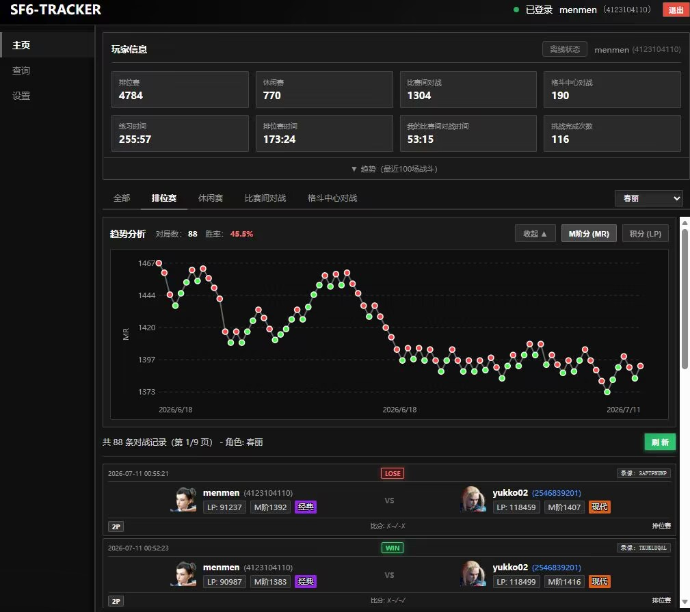

# SF6 Tracker

当前开发版本：**v0.7**。

《街头霸王 6》玩家战绩查询与复盘工具。FastAPI 提供本机服务，原生 HTML / CSS / JavaScript 展示数据，pywebview 提供 Windows 桌面窗口。



## 功能

- 查询自己或其他玩家的近期对战记录，查看胜负、角色、LP / MR 趋势。
- 查看角色对阵统计、排行榜与格斗圈。
- 排行榜统计提供MR中位数、实际门槛、角色头部占比、地区与代表玩家；这些是当前榜单样本，不是角色强度榜。
- 在“角色对阵”旁切换“训练分析”，查看关键数字、短板对局和事实标签；可手动加载同角色榜首/前3名样本，用分类条形图对比习惯。统计说明按需展开。
- 训练分析复用头像角色选择器，可“抽一场败局”复制录像ID、加入现有待复盘收藏；不额外采集对局。
- “对策笔记”只提供“我的角色 → 对手角色”的单文本框，自行编辑、自动本地保存；不提供攻略内容或验证状态，支持JSON备份及旧笔记迁移。见 [笔记说明](matchup-notes.md)。
- 排行榜统计提供紧凑分布、MR门槛对照和榜单看点；角色参考支持排序、头像筛选、点击占比定位，长列表与更多参考默认收起。
- 收藏玩家和对局；收藏对局卡片内可展开“对局备注”编辑，自动保存，收起后显示摘要。
- 支持主题与布局密度设置。
- 在线查询成功后自动归档战绩，通过“本地历史”入口离线查看已保存的数据。

在线页面是主要入口；本地历史是补充功能，不替代在线数据，也不要求切换登录账号。历史只按被查询玩家的 ID 保存，同一玩家的录像去重合并，旧记录不会因后续查询未返回而被删除。

本地历史复用在线页面的玩家资料、游玩时间、对战统计、角色对阵、趋势图和战绩卡片。玩家资料以用户 ID 为主键保存最新快照，后续成功查询会更新；资料抓取失败不会覆盖已有快照。旧版历史需要成功在线查询一次才能补齐资料。本地显示资料保存时间，不将快照中的在线状态当作实时状态。

本地玩家选择旁的“更新数据”会联网获取该玩家近期战绩与资料，再合并到本地；需要先登录。列表中的“刷新”仍只重读本地数据。更新期间旧记录可继续查看，失败可重试，旧历史不会被清空。

在线采集按返回顺序持续推送进度，连续的前几页先显示，其余页面和资料继续加载，完成后再确认完整性并归档。采集使用有界并发，确认空页后停止安排后续页；临时失败页并发重试，传输层已耗尽重试次数的请求不再叠加整轮重试。前端合并重复点击产生的相同在途请求。完整采集时间仍受官网响应影响，方案与测量方式见 [采集性能说明](collection-performance.md)。

官网近期记录不等于完整历史；本地积累从首次保存开始，无法恢复此前官网已不提供的对局。官网整体统计与当前记录统计的覆盖范围可能不同，请避免频繁查询。

## 下载与使用

从 [Releases](https://github.com/HuuuugePony/sf6-tracker/releases) 选择已发布的 Windows 版本，解压（如有）后运行程序。发布包可能落后于开发分支，以对应版本说明为准。

1. 启动应用，点击“登录” → “打开默认浏览器访问官网”，在平常使用的浏览器手动完成 CAPCOM 登录与人机验证。
2. 按弹窗中的“如何获取 Cookie”导入 Buckler Cookie，再点击“验证 Cookie 并登录”。应用不接收账号密码，也不会自动读取普通浏览器资料。
3. 在主页查看自己的战绩，或在查询页查找其他玩家。
4. 离线回看时打开“本地历史”，选择已保存的玩家，无需重新登录。

Windows 桌面运行需要 Microsoft Edge WebView2 Runtime。备用“Edge 自动读取 Cookie”仍使用 WebDriver 临时窗口，不保证能通过官网人机验证；不要反复尝试或以换浏览器作为必定有效的解决方案。登录过期后需要重新验证，本地战绩不依赖官网登录状态。详见 [登录可靠性与安全边界](login-reliability.md)。

## 本地开发

使用独立 Python 虚拟环境。仓库没有前端构建步骤，运行时从 `web/` 读取静态资源。

```powershell
python -m venv .venv
.\.venv\Scripts\python.exe -m pip install -r requirements.txt

# 桌面窗口
.\.venv\Scripts\python.exe desktop_app.py

# 或仅启动本机 Web 服务
.\.venv\Scripts\python.exe main.py
```

Web 模式打开 `http://127.0.0.1:7648`。桌面模式也使用此端口，两种模式不要同时启动。服务只应监听本机，不应暴露到公网或作为多用户服务部署。

安装开发依赖并运行离线回归测试（前端测试另需 Node.js）：

```powershell
.\.venv\Scripts\python.exe -m pip install -r requirements-dev.txt
.\.venv\Scripts\python.exe -m unittest discover -s tests -v
node --test tests/frontend_reliability.test.js
```

测试使用模拟响应和独立临时数据库，不需要真实 Cookie。完整 Edge 登录、WebView2 窗口和打包产物需另行手动验收。

## 打包

```powershell
.\.venv\Scripts\python.exe -m PyInstaller sf6tracker.spec --clean --noconfirm
```

产物位于 `dist/`，名称以 `sf6tracker.spec` 为准。打包前确认资源清单没有本地账号文件、日志或数据库。

## 项目结构

| 路径 | 用途 |
| --- | --- |
| `main.py` | 本机 API 与页面入口 |
| `crawler.py` / `battle_data.py` | 官网数据请求与战绩解析 |
| `login_sessions.py` | 登录会话生命周期 |
| `desktop_app.py` / `desktop_styles.css` | 桌面启动与专用样式 |
| `history_store.py` / `history_api.py` | SQLite 归档与离线读取 |
| `web/` | 页面、样式及按职责划分的脚本 |
| `tests/` | 离线回归测试与合成数据预览服务 |
| `sf6tracker.spec` | Windows 打包配置 |

脚本边界见 [前端架构说明](frontend-architecture.md)。开发时保留现有在线界面的数据内容、顺序和布局；新增功能应复用已有风格，不以“优化”为由重排页面。

统计的口径、训练目标情景与高手参照限制见 [玩家数据分析说明](analytics-design.md)。高手参考只在手动点击时联网读取最多3份资料，服务缓存10分钟；浏览器可保留公开样本快照供离线查看。Cookie不会写入这些快照。

## 数据与隐私

- 历史数据库默认位于 `%LOCALAPPDATA%/SF6Tracker/history.sqlite3`，可用 `SF6_TRACKER_DATA_DIR` 指定其他目录。备份时先退出应用，再复制整个数据目录。
- 新登录默认将 Cookie 保存在本次标签页 / WebView 会话；只有勾选“在此设备记住登录”才长期保存到 localStorage，**未加密**。现有记住的登录保持兼容，退出登录后清除；浏览器恢复标签页时也可能恢复会话数据。收藏、备注与登录分别保存，历史数据库不保存 Cookie。
- 本地历史不是多用户权限系统：能访问此电脑及数据目录的人也可能读取它。
- 日志、缓存、调试响应和测试账号文件不应提交。分享日志前检查其中的玩家信息或认证数据。
- 不要在 Issue、提交、截图或测试夹具中附带真实 Cookie；已公开的凭据应及时失效处理。

## 分支与贡献

维护两个长期本地分支：`main`（稳定发布）和 `develop`（日常开发）。提交格式、验收要求和远端迁移步骤见 [贡献与 Git 规范](CONTRIBUTING.md)。

问题反馈：[Issues](https://github.com/HuuuugePony/sf6-tracker/issues)。本项目为非官方工具，与 CAPCOM 无隶属关系；游戏及相关素材的权利归其权利人所有。
